# ☁️ Awesome Managed Cloud Detection & Response (CDR / MDR) 🛡️

<p align="center">
  
</p>

<p align="center">
  <a href="https://github.com/ishandutta2007/Awesome-Managed-Cloud-Detection-Response/stargazers"></a>
  <a href="https://github.com/ishandutta2007/Awesome-Managed-Cloud-Detection-Response/network/members"></a>
  <a href="https://github.com/ishandutta2007/Awesome-Managed-Cloud-Detection-Response/blob/main/LICENSE"></a>
  <a href="https://github.com/ishandutta2007/Awesome-Managed-Cloud-Detection-Response/pulls"></a>
  
</p>

---

## 🧭 Executive Summary & Focus

A curated directory and vendor guide for **Managed Cloud Detection & Response (Cloud MDR / CDR)** platforms, SOC services, and companion open-source threat hunting utilities.

This guide is designed for Chief Information Security Officers (CISOs), Cloud Security Architects, and SecOps Leads seeking 24/7 proactive threat monitoring, control plane abuse prevention, Kubernetes runtime defense, and rapid incident containment across **AWS**, **Microsoft Azure**, **Google Cloud Platform (GCP)**, and hybrid architectures.

---

## 📊 Sector Overview & Market Dynamics

> 📈 **Market Size & Growth**: The global Managed Detection and Response (MDR) market is valued at approximately **$5.1B to $6.2B in 2025–2026** and is projected to expand to **$17.6B–$19.8B by 2032**, demonstrating an accelerated compound annual growth rate (CAGR) of **~21.4%**.
>
> 🧩 **Market Concentration & Structure**: The sector is **moderately to highly fragmented** rather than a winner-take-all monopoly. Competition is split dynamically across pure-play MDR specialists (e.g., Arctic Wolf, Expel, eSentire), hyper-growth cloud security platforms (e.g., Wiz), and consolidated endpoint/network security conglomerates (e.g., Palo Alto Networks, CrowdStrike, Sophos).

---

## 📑 Table of Contents
- [📊 Sector Overview & Market Dynamics](#-sector-overview--market-dynamics)
- [🏢 Enterprise SaaS & Managed Cloud Detection Providers](#-enterprise-saas--managed-cloud-detection-providers)
- [🛠️ Open-Source Cloud Detection & Incident Response Projects](#️-open-source-cloud-detection--incident-response-projects)
- [🔍 Architectural Difference: Managed MDR vs. Self-Hosted CDR](#-architectural-difference-managed-mdr-vs-self-hosted-cdr)
- [🤝 How to Contribute](#-how-to-contribute)
- [⚖️ Disclaimer & Compliance Notes](#️-disclaimer--compliance-notes)

---

## 🏢 Enterprise SaaS & Managed Cloud Detection Providers

Below is a detailed comparison of market-leading managed cloud detection and response providers, sorted in descending order by **Company Scale (Market Capitalization / Enterprise Valuation)**.

| 🏢 Provider | 📈 Company Scale (Valuation / Market Cap) | 💵 Starting Tier Pricing | 🎁 Free Tier / Free Trial Limits | 🛡️ Core Cloud Detection & Response Focus |
| :--- | :--- | :--- | :--- | :--- |
| **[Palo Alto Unit 42 Managed Cloud](https://www.paloaltonetworks.com/)** | **~$275B–$320B** Market Cap *(PANW, FY26 Rev: ~$11.5B)* | **~$10.00 – $15.00** per endpoint/mo (Software base); MDR packages custom quoted | **30-Day Guided PoC** (Virtual sandbox lab environment with demo data via authorized partners) | Frontline SOC triage, Cortex XDR/XSIAM integration, and Unit 42 proactive control-plane threat hunting across AWS, Azure, and GCP. |
| **[CrowdStrike Falcon Complete Cloud Security](https://www.crowdstrike.com/)** | **~$250B–$270B** Market Cap *(CRWD, FY26 Rev: ~$4.8B)* | **~$184.99** per device/year (~$19.99/mo) for Falcon Enterprise tier; Complete MDR priced via private quote | **15-Day Free Trial** (Full access to Falcon Prevent NGAV, Device Control, and cloud trial modules for up to 100 endpoints) | 24/7 OverWatch threat hunting, sub-60-minute surgical host remediation, agentless multi-cloud visibility, and $1M Breach Prevention Warranty. |
| **[Wiz MDR (via partners)](https://www.wiz.io/)** | **$32B** Valuation *(Acquired by Google/Alphabet; $1B+ ARR)* | **~$24,000 / year** (Wiz Essential via AWS Marketplace, covering 100 cloud workloads) | **14-Day Free Trial** (Full agentless scanning across 1 connected cloud account with interactive cloud security graph) | Graph-based cloud risk correlation combined with 24/7 human SOC operationalization through the Wiz Integration Network (WIN). |
| **[Arctic Wolf Cloud Detection](https://arcticwolf.com/)** | **$4.3B** Valuation *(Series F; ~$400M–$450M ARR)* | **~$8.00 – $18.00** per user/workload per month (~$100–$220/yr, ~$24K annual SMB minimum) | **30-Day Virtual Concierge Assessment** (Scattered telemetry ingestion & threat posture evaluation with sales engineer review) | Dedicated Concierge Security Team (CST), multi-cloud log monitoring (CloudTrail, Azure Activity, GCP), and cross-domain correlation. |
| **[Sophos Cloud MDR](https://www.sophos.com/)** | **$3.9B** Valuation *(Acquired by Thoma Bravo; ~$1B+ Revenue)* | **~$10.00 – $20.00** per endpoint/mo (~$120–$240/yr for MDR Complete tier) | **30-Day Free Trial** (Unrestricted trial of Sophos Central & Intercept X Advanced with XDR; MDR human SOC demo upon request) | Agentic SOC architecture where 52% of alerts are resolved in <90 seconds with human analyst containment and customizable response modes. |
| **[Expel Cloud MDR](https://expel.com/)** | **$1.0B** Valuation *(Series E Unicorn; ~$100M–$140M ARR)* | **~$11,600 / year** (Starting enterprise block for ~125 assets/workloads) | **14-Day Custom PoC** (Live integration pilot in staging or production with automated alert enrichment) | Tool-agnostic managed security across AWS, Azure, GCP, and OCI; native control-plane hunting (IAM abuse, API hijacking, and bucket misconfigurations). |
| **[eSentire Cloud Security](https://www.esentire.com/)** | **$1.0B+** Valuation *(Warburg Pincus backed unicorn; ~$165M Rev)* | **~$12.00 – $18.00** per workload/mo (Typically requires a minimum contract baseline of ~$15,000/yr) | **30-Day Threat Exposure Assessment** (Cloud posture audit and guided SOC telemetry correlation demonstration) | Controlled Autonomy SecOps combining agentic AI operatives with human threat analysts, rapid TCP disruption, and automated user suspension. |
| **[Rapid7 Cloud MDR](https://www.rapid7.com/)** | **~$850M–$1.1B** Market Cap *(NASDAQ: RPD; ~$700M+ Revenue)* | **~$15.00 – $22.00** per asset/month (Managed Threat Complete tier with a 500-asset minimum baseline) | **30-Day Free Trial** (Full evaluation of InsightIDR & InsightCloudSec platform; live MXDR triage requires partner onboarding) | Deep AWS GuardDuty & CloudTrail triage, integrated CNAPP posture management, and behavioral analytics on privileged cloud identities. |
| **[Secureworks Taegis Cloud MDR](https://www.secureworks.com/)** | **$859M** Acquisition Valuation *(Acquired by Sophos / Thoma Bravo)* | **~$120.00 – $220.00** per protected host/endpoint per year (~$10–$18.33/mo) | **30-Day Free Trial** (Taegis XDR platform trial with 350+ data connectors enabled; MDR SOC analyst access upon qualification) | Open-XDR architecture, sub-minute median detection times, 5-minute remote incident remediation, and live security analyst chat in <90 seconds. |
| **[Red Canary Cloud Defense](https://redcanary.com/)** | **$675M** Acquisition Valuation *(Acquired by Zscaler; ~$140M ARR)* | **~$12.00 – $16.00** per endpoint/workload per month (~$144–$192/yr, billed annually) | **30-Day Proof of Value (PoV)** (Full telemetry ingestion on up to 250 assets with dedicated incident response analyst support) | Cross-domain alert validation, multi-cloud runtime telemetry correlation, and mapped MITRE ATT&CK cloud sub-technique containment. |

---

## 🛠️ Open-Source Cloud Detection & Incident Response Projects

Open-source CDR projects provide self-hosted telemetry pipelines, detection rulesets, runtime agents, and forensic hunt utilities. 

The repositories below are sorted in descending order by **GitHub Star Count**. Click on any star badge to view real-time stargazers.

| 📦 Repository & Project | ⭐ GitHub Stars | 💻 Primary Language | 🎯 Key Cloud Detection, IR & Posture Capabilities |
| :--- | :--- | :--- | :--- |
| **[osquery/osquery](https://github.com/osquery/osquery)** | [](https://github.com/osquery/osquery/stargazers) | C++ | SQL-powered operating system instrumentation framework. Highly effective for querying cloud virtual machines, containers, and serverless hosts as a relational database for live security auditing and intrusion detection. |
| **[wazuh/wazuh](https://github.com/wazuh/wazuh)** | [](https://github.com/wazuh/wazuh/stargazers) | C / Python | Open-source SIEM/XDR engine offering security monitoring, cloud audit log analysis (AWS CloudTrail, Azure Monitor, GCP Audit), threat detection, file integrity monitoring (FIM), and automated response scripts. |
| **[prowler-cloud/prowler](https://github.com/prowler-cloud/prowler)** | [](https://github.com/prowler-cloud/prowler/stargazers) | Python | Cloud Security Posture Management (CSPM) and compliance assessment tool for AWS, Azure, GCP, and Kubernetes. Essential baseline for auditing configurations before wiring up CDR alerting. |
| **[elastic/beats](https://github.com/elastic/beats)** | [](https://github.com/elastic/beats/stargazers) | Go | Lightweight data shippers including `Cloudbeat` and `Auditbeat`. Ships cloud runtime events, CIS benchmark audits, and Kubernetes control-plane telemetry to OpenSearch or Elasticsearch clusters. |
| **[falcosecurity/falco](https://github.com/falcosecurity/falco)** | [](https://github.com/falcosecurity/falco/stargazers) | C++ / eBPF | The de facto cloud-native runtime security tool and CNCF graduated project. Monitors Linux kernel system calls via eBPF to detect unexpected application behavior, shell spawns, and privilege escalations in Kubernetes. |
| **[open-telemetry/opentelemetry-collector](https://github.com/open-telemetry/opentelemetry-collector)** | [](https://github.com/open-telemetry/opentelemetry-collector/stargazers) | Go | Vendor-agnostic proxy to ingest, transform, and route security events, cloud metrics, and audit logs to upstream SIEM and CDR analysis pipelines. |
| **[Netflix/dispatch](https://github.com/Netflix/dispatch)** | [](https://github.com/Netflix/dispatch/stargazers) | Python | All-in-one incident management and orchestration framework built by Netflix. Streamlines cloud security incident triage, automates team notifications, syncs Slack/Jira/Google Docs, and structures remediation workflows. |
| **[cloud-custodian/cloud-custodian](https://github.com/cloud-custodian/cloud-custodian)** | [](https://github.com/cloud-custodian/cloud-custodian/stargazers) | Python | Rules engine for cloud security, governance, and real-time event-driven remediation. Listens to AWS EventBridge and Azure Event Grid to instantly terminate unauthorized infrastructure or revoke IAM permissions. |
| **[aquasecurity/tracee](https://github.com/aquasecurity/tracee)** | [](https://github.com/aquasecurity/tracee/stargazers) | Go / C | eBPF-powered container runtime security and forensic data-collection engine. Detects suspicious behavioral patterns in cloud workloads and streams forensic telemetry in real time. |
| **[BishopFox/cloudfox](https://github.com/BishopFox/cloudfox)** | [](https://github.com/BishopFox/cloudfox/stargazers) | Go | Command-line tool designed for proactive threat hunters and penetration testers to discover exploitable attack paths, over-permissioned IAM roles, and exposed data stores in cloud environments. |
| **[panther-labs/panther-analysis](https://github.com/panther-labs/panther-analysis)** | [](https://github.com/panther-labs/panther-analysis/stargazers) | Python | Open-source detection-as-code library containing production-ready rules for AWS CloudTrail, GuardDuty, GCP Audit Logs, Okta, and Kubernetes audit logs. |
| **[dbnz-io/dredge](https://github.com/dbnz-io/dredge)** | [](https://github.com/dbnz-io/dredge/stargazers) | Python | Advanced CLI toolkit (`pip install dredge-ir`) built specifically for cloud IR. Concurrently queries AWS CloudTrail across all regions, builds unified chronological incident timelines, and executes automated IAM/S3 containment. |
| **[dbnz-io/opencdr](https://github.com/dbnz-io/opencdr)** | [](https://github.com/dbnz-io/opencdr/stargazers) | Python / JS | Serverless event-driven Cloud Detection & Response data plane for AWS. Ingests CloudTrail and GuardDuty events via EventBridge and pushes alerts with optional auto-response modules to Slack, Discord, and Webhooks. |

---

## 🔍 Architectural Difference: Managed MDR vs. Self-Hosted CDR

```
               ┌────────────────────────────────────────────────────────┐
               │           Cloud Telemetry & Audit Logs                 │
               │   (AWS CloudTrail, Azure Activity, GCP Audit, K8s)      │
               └───────────────────────────┬────────────────────────────┘
                                           │
                    ┌──────────────────────┴──────────────────────┐
                    ▼                                             ▼
     ┌─────────────────────────────┐               ┌─────────────────────────────┐
     │  Open-Source CDR Tooling    │               │    Managed Cloud MDR SOC    │
     │  (Falco, Dredge, OpenCDR)   │               │ (CrowdStrike, Expel, Wiz)   │
     ├─────────────────────────────┤               ├─────────────────────────────┤
     │ • Free software licenses    │               │ • 24/7/365 Human SOC eyes   │
     │ • In-house alert triage     │               │ • SLA-backed containment    │
     │ • Operator writes rules     │               │ • Cross-customer intel      │
     │ • Risk of alert fatigue     │               │ • Dedicated DFIR escalations│
     └─────────────────────────────┘               └─────────────────────────────┘
```

> ⚠️ **Key Takeaway**: Open-source provides **tooling**, while Managed Detection & Response delivers a **team**. If your organization does not maintain dedicated 24/7 internal cloud incident responders, relying solely on open-source tools will create unmonitored alert backlogs.

---

## 🤝 How to Contribute

Contributions, vendor corrections, and additions of active open-source security tools are very welcome!

1. 🍴 **Fork** this repository.
2. 🌿 Create a descriptive feature branch: `git checkout -b feature/add-new-cdr-tool`.
3. 📝 Update `README.md` following the tabular format and add relevant documentation links.
4. 🚀 Push your changes and submit a clean **Pull Request (PR)**.

---

## ⚖️ Disclaimer & Compliance Notes

* 📌 This repository is a community-curated list maintained for educational, architectural, and evaluation purposes.
* 🛡️ Deployment of cloud security tools and SOC integrations must conform to internal corporate governance, data privacy standards (GDPR, HIPAA, SOC 2), and cloud provider acceptable use policies.
* ⚠️ Always thoroughly test automated containment modules in staging environments prior to arming production response automation.

---

<p align="center">
  <b>⭐ Star this repository if it helps streamline your cloud defense strategy! ⭐</b>
</p>
